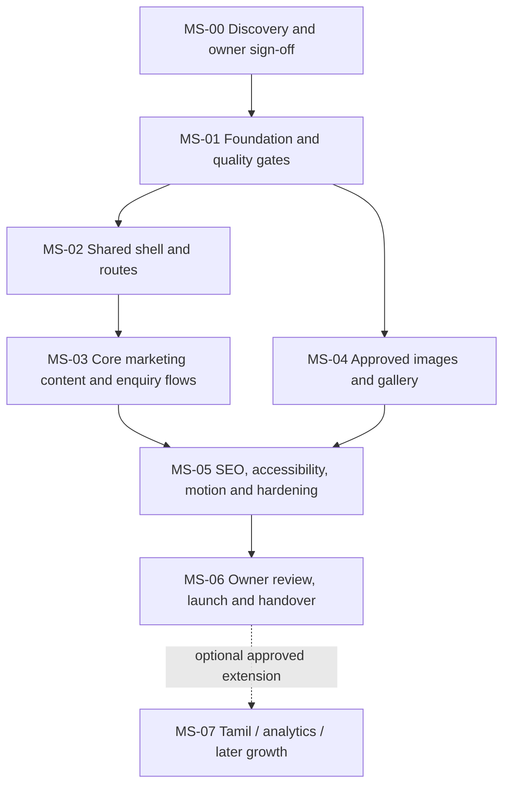

# Development Milestones and Release Roadmap

**Document ID:** ROADMAP-KBS-001  
**Version:** 1.0 initial baseline  
**Status:** All milestones planned; implementation has not started

## 1. Delivery principles

- Do not start production implementation until `MS-00` has cleared its owner-facing gates. Low-risk scaffolding may be prepared, but uncertain business facts must not be hard-coded into public copy.
- Build the simplest static solution that satisfies the PDR. There is no backend, database, login, CMS, checkout or booking engine in release 1.
- Keep each milestone demonstrable using a preview deployment or locally runnable site.
- Photo permission and factual approval are release gates, not optional polish.
- If an owner response is late, use approved safe fallback copy and keep uncertain content unpublished rather than inventing values.

## 2. Milestone map

## 3. Milestone details

### MS-00 — Discovery, requirements and owner approvals

- **Priority:** P0; blocks public-content implementation and launch.
- **Goal:** replace assumptions with owner-confirmed business facts, content boundaries and permission decisions.
- **Deliverables:** confirmed brand spelling; verified phone/WhatsApp; verified Instagram; exact map pin or decision to omit directions; current service list; course confirmation; palette decision; language decision; approved image/consent inventory; hosting/domain owner; release content checklist.
- **Dependencies:** this blueprint and the supplied image contact sheet.
- **Tasks:** T-001–T-004.
- **Validation:** US-011 and US-012; TC-001, TC-016, TC-019.
- **Definition of done:** required decisions are recorded in `STATUS.md`; unknown values are intentionally omitted from public content; any unapproved images are flagged as non-publishable.
- **Not done when:** the team assumes the contact number, address/hours, course fee, membership benefits, image rights or theme are confirmed simply because they appear in a poster/mockup.

### MS-01 — Project foundation and quality baseline

- **Priority:** P0.
- **Goal:** establish a reproducible static-site repository with development checks before adding content.
- **Deliverables:** Astro static project, strict TypeScript, agreed Node runtime, one package manager and lockfile, lint/format scripts, test scaffolding, README, branch/deploy preview setup.
- **Dependencies:** MS-00 can run in parallel for some generic setup; business content must remain configurable.
- **Tasks:** T-005–T-006.
- **Validation:** US-013; TC-014.
- **Definition of done:** a clean checkout installs from the lockfile, development server starts, static production build succeeds, checks run in a documented sequence, and no credentials are committed.

### MS-02 — Design system, shared shell and routes

- **Priority:** P1 after foundation.
- **Goal:** create the overall visual and navigation structure for all seven pages.
- **Deliverables:** central light-theme tokens; typography and spacing system; shared layout, header, footer, CTA patterns; responsive mobile menu; all routes with semantic headings and basic content placeholders clearly kept internal/unpublished.
- **Dependencies:** MS-01; palette approval recommended. If palette decision is pending, implement the proposed lavender/sage token set as easy-to-replace variables.
- **Tasks:** T-007–T-009.
- **Validation:** US-001, US-010; TC-002, TC-011–TC-013, TC-017.
- **Definition of done:** all routes resolve directly, refresh works, mobile navigation works with keyboard/touch, no search field/theme picker/dark-mode switch, and no reveal animation can hide page content.

### MS-03 — Core copy, services, course, contact and enquiry hand-off

- **Priority:** P0/P1; core business value.
- **Goal:** make site routes useful and enable visitors to contact the salon without backend infrastructure.
- **Deliverables:** approved home sections; service route; bridal route; course route; about route; membership teaser; jewellery teaser; contact/FAQ content; typed central business config; WhatsApp link constructor; validated enquiry-to-WhatsApp flow.
- **Dependencies:** MS-02; relevant owner content sign-offs from MS-00.
- **Tasks:** T-010–T-017.
- **Validation:** US-001–US-004, US-006–US-009; TC-001, TC-003–TC-005, TC-008–TC-010, TC-019–TC-020.
- **Definition of done:** core routes contain accurate approved content, unconfirmed values do not render as facts, contact destinations work, the form validates/encodes data, and it is clear the user must send the message in WhatsApp.

### MS-04 — Image approval, optimisation and gallery

- **Priority:** P1; can progress alongside MS-03 after permissions are resolved.
- **Goal:** use a deliberate, permission-cleared subset of supplied imagery while remaining ready to swap in high-resolution originals later.
- **Deliverables:** reviewed asset manifest; approved image copies/imports; responsive image renditions; meaningful alt text; gallery category filtering; accessible lightbox; fallback for empty categories/missing images.
- **Dependencies:** MS-00 permission decisions and MS-01 image pipeline.
- **Tasks:** T-018–T-021.
- **Validation:** US-002, US-005, US-012; TC-006, TC-007, TC-016.
- **Definition of done:** every public image is marked approved, source-only assets are not copied into public output, responsive images render at suitable dimensions, and keyboard/touch interaction passes.

### MS-05 — SEO, accessibility, motion and release hardening

- **Priority:** P1; mandatory before launch.
- **Goal:** validate trustworthiness, crawlability, usability and stability.
- **Deliverables:** route-specific metadata, canonical URLs, Open Graph, sitemap, robots policy, accurate structured data, reduced-motion-safe GSAP reveals, accessibility review, automated tests, responsive/browser and performance review.
- **Dependencies:** MS-03 and MS-04; production domain decision.
- **Tasks:** T-022–T-028.
- **Validation:** US-009, US-010, US-013, US-014 if approved; TC-010–TC-014, TC-017–TC-020.
- **Definition of done:** no P0 defects; P1 tests pass or are explicitly waived with owner sign-off; structured data is valid and truthful; performance/accessibility reports reviewed; no blocked content or animation-induced invisible sections.

### MS-06 — Owner preview, correction, production launch and handover

- **Priority:** P0 release gate.
- **Goal:** ensure the live site reflects owner-approved copy/assets and the owner controls the production assets/accounts.
- **Deliverables:** preview link; owner feedback log; corrections; final content approval; production deployment; smoke-test result; account/domain/rollback handover; update instructions.
- **Dependencies:** MS-05; host and domain access.
- **Tasks:** T-029–T-032.
- **Validation:** US-011–US-013; TC-001, TC-014–TC-016, TC-019.
- **Definition of done:** explicit owner go-live approval; HTTPS production site; routes/assets/outbound actions smoke-tested; site backups/rollback path known; owner has control of repository/host/domain or a documented agreement states who controls them.

### MS-07 — Optional approved extensions and future work

- **Priority:** P2; not a release blocker.
- **Goal:** implement only extensions that receive explicit approval and scope.
- **Potential deliverables:** fully reviewed Tamil language toggle; privacy-approved analytics; blog/content plan; richer membership/course pages; a separately scoped jewellery website with its own requirements.
- **Dependencies:** MS-06 and a new decision/scope note.
- **Tasks:** T-033–T-035.
- **Validation:** TC-018, TC-020 and any additional tests defined before implementation.
- **Definition of done:** feature is scoped, owner-approved, privacy/licensing implications considered, tests/acceptance criteria added, and `PDR.md`, `TASK.md`, `STATUS.md` are updated before coding.

## 4. Definition of done for each task

A task is complete only when all conditions apply:

1. Requirements/story/test links have been checked.
2. Code/data is reviewed and follows the repository's style/type rules.
3. No unrelated or unapproved content was introduced.
4. Automated checks pass and manual checks are recorded where needed.
5. Mobile and keyboard behaviour is checked for user-facing UI.
6. Docs/status/backlog are updated if behaviour, scope or decisions changed.
7. Preview is reviewed before production and changes are not labelled launched until the deploy smoke test passes.

## 5. Release gates

| Gate | Required evidence | Blocked by |
|---|---|---|
| G-00 Content safety | Verified brand/phone/services, image consent inventory, no invented facts | Any unresolved P0 content or permission issue |
| G-01 Build readiness | Reproducible install/build/lint/typecheck | Failing build/check |
| G-02 UX readiness | Direct routes, mobile nav, forms, gallery, reduced-motion behaviour | Broken primary path, inaccessible menu/form/lightbox |
| G-03 Trust/SEO | Unique metadata, valid structured data, no placeholder reviews/prices/hours | Fabricated claims or invalid public URLs |
| G-04 Launch readiness | Owner approval, production smoke test, HTTPS, account handover | Missing approval or critical defects |

## 6. Indicative sequencing

Effort should be estimated by the implementing team after MS-00. This roadmap deliberately does not promise a calendar delivery date before asset permissions, content and hosting access are resolved. A reasonable sequence is foundation → shell → content/WhatsApp → approved images/gallery → SEO/accessibility → owner review → launch.
