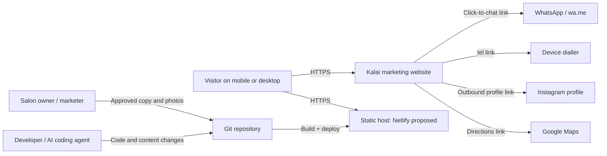
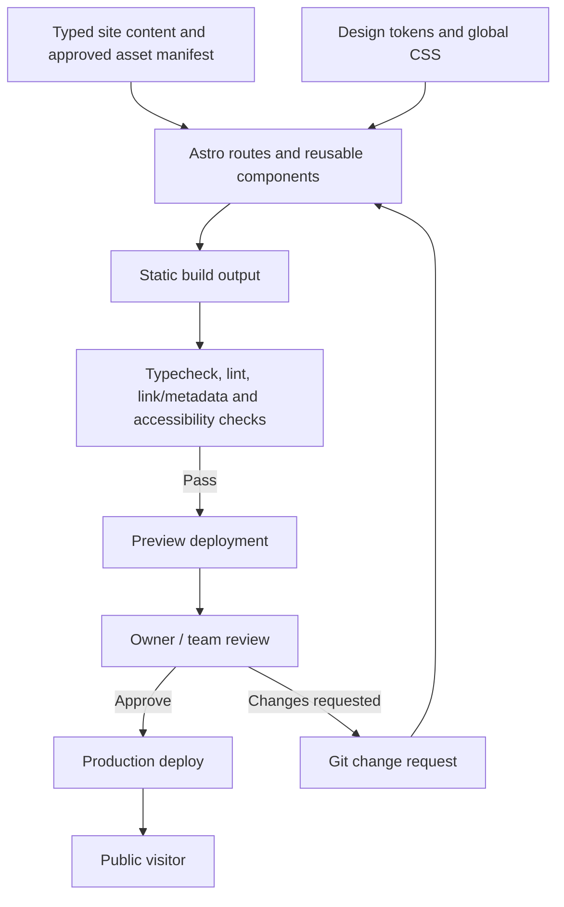
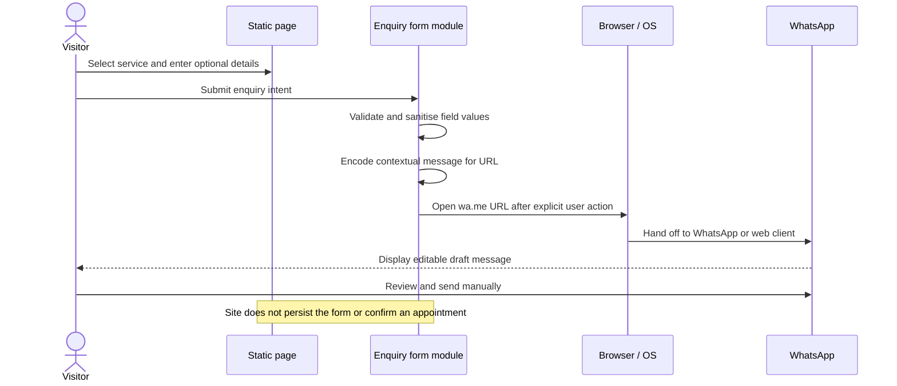
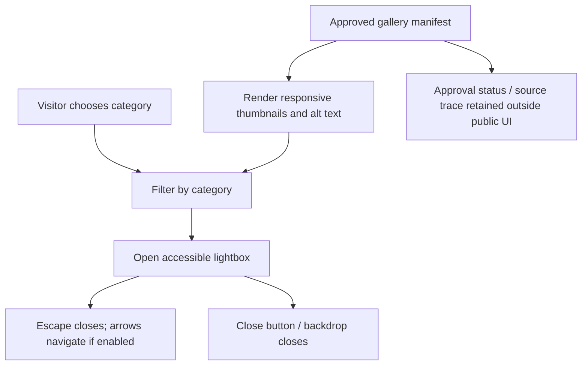

# System Architecture

**Document ID:** ARCH-KBS-001  
**Version:** 1.0 initial baseline  
**Status:** Proposed; stack and hosting approval pending

## 1. Architecture summary

Build a statically generated, multi-route marketing website. The site does not need a custom backend: service content, course topics, FAQs and approved gallery references are structured source data rendered into HTML at build time. Interactive behaviour is limited to accessible UI enhancements (mobile navigation, gallery lightbox/filter, language option if approved, enquiry-to-WhatsApp hand-off, and optional scroll reveals).

### Proposed stack

| Concern | Recommendation | Why / trade-off |
|---|---|---|
| Web framework | Astro with static output | Strong fit for content-oriented sites; generates static HTML and avoids shipping a client framework for every section. A plain HTML/CSS/JS implementation is an acceptable simpler alternative only if it still meets route, accessibility and maintainability requirements. |
| Language | TypeScript, strict mode | Central typed site configuration, gallery records, FAQs and service data reduce errors in content-driven code. |
| Styling | CSS custom properties + component styles; CSS Grid/Flexbox | Lightweight, no need for a large component framework. Build tokens for one light theme. |
| Motion | GSAP core + ScrollTrigger as an optional enhancement | Matches the requested section/hero reveal direction. Motion must not gate content and must respect reduced-motion settings. Avoid unnecessary 3D/continuous effects. |
| Images | Astro image pipeline for selected source assets; responsive modern formats where supported | Keep large source image files out of the public route; generate sizes suitable for their display. Preserve originals separately. |
| SEO | Static metadata components + Astro sitemap integration | Predictable route metadata and sitemap at build time. Validate schema rather than assuming it is correct. |
| Version control | Git repository hosted under owner/company-controlled account | Reviewable changes and rollback. |
| CI/deploy | Netlify connected to Git as proposed default | Preview deploys, static hosting, HTTPS and simple rollback. Hosting vendor can be changed without redesign. |
| Database/backend | None in release 1 | No login, persistent booking, inventory or online payment requirement. |
| External integrations | WhatsApp click-to-chat, phone URI, Instagram profile, Google Maps directions | User-triggered outbound actions only. No credentials or API keys are needed for these links. |

Exact dependency versions must be selected and locked when scaffolding, with the active Node.js LTS runtime pinned in project configuration. Do not float unbounded dependency versions in the committed manifest.

## 2. Context and system boundary

The website does not control WhatsApp, Instagram, a phone dialler or Google Maps. A CTA only opens an external service; the external service may require the visitor to sign in or may not be installed. A click does not confirm a booking.

## 3. Build and delivery architecture

If checks fail, the production deployment must not be promoted. A preview is not production approval.

## 4. Logical layers

1. **Content layer:** `src/data/site.ts`, `services.ts`, `faqs.ts`, `gallery.ts`, optional `translations/` and a public contact config. Content fields include approval state and alt text where useful.
2. **Page layer:** seven static routes. Pages compose components; they should not repeat phone numbers or theme values inline.
3. **Presentation layer:** global design tokens, responsive layout, accessible components, no dark theme, consistent header/footer/mobile contact actions.
4. **Interaction layer:** small, isolated TypeScript modules for menu, gallery filters/lightbox, enquiry form and animation. All content remains useful without these enhancements.
5. **Build and delivery layer:** static output, lint/typecheck/build, test scripts, preview deployment, owner approval and production promotion.
6. **External boundary:** `wa.me`, `tel:`, Instagram and Maps URLs. These are outbound links, not internal APIs.

## 5. Main data flow

### Enquiry flow

### Gallery flow

## 6. Deployment topology

**Primary recommendation:** Git repository → Netlify build from the production branch → static assets served over HTTPS. Create the hosting account and domain under the business or its authorised provider—not a developer's personal account. Use a preview deployment for every substantial change.

**Alternatives:** Cloudflare Pages or another static host if the owner already controls it. Do not add Cloudflare Workers, Netlify Functions, serverless APIs or a database merely because the provider supports them; release 1 does not need them.

### Environment configuration

- Public site URL/canonical URL: set through a documented site config/build variable, then verify it in production.
- No secret environment variables are expected in release 1.
- Do not expose tokens or private owner information in client bundles.
- No development `.env` is required unless a later approved integration adds one. If used, provide `.env.example` with names only and never commit real credentials.

## 7. Security and privacy boundaries

- Static website: no user account system, session, backend API or database.
- Form inputs are used to build a WhatsApp URL in memory. Do not send the values to analytics, logs, a database or a third-party form service.
- Encode all user-provided values before placing them in a URL; cap unreasonable lengths; avoid arbitrary user-controlled URL destinations.
- Use `rel="noopener noreferrer"` for external links opened in new tabs.
- The only supported form destination is a constant configured WhatsApp number. Users do not supply an alternate URL or phone destination.
- Never commit private photo releases, contact lists, raw personal image files or access credentials to the production repository. Approved public assets only.
- Deploy with HTTPS and a host-supplied security baseline. Add CSP/security headers if supported by the chosen host, permitting only required sources (site origin, approved font/image/CDN sources). Prefer vendored/package-managed GSAP to an unpinned external script.
- No analytics/pixels until the owner approves privacy implications. Avoid embedding third-party social feeds; link out to Instagram instead.
- Obtain appropriate permission before publishing recognisable people, client images, certificate photos, or children. If consent is unclear, do not publish the image.

## 8. SEO and discovery architecture

- Each route has its own title, description, canonical URL and Open Graph title/description/image.
- Include a valid sitemap and a `robots.txt` appropriate to the environment. Preview builds should not be indexed; production should be crawlable when ready.
- Use semantic headings, plain HTML content and crawlable internal links.
- Use `BeautySalon`/appropriate `LocalBusiness` JSON-LD only for known fields. Do not include fake `aggregateRating`, reviews, street address, coordinates, hours or prices.
- If exact address and opening hours remain unavailable, omit those structured data fields rather than making them up. Visible page facts and structured data must match.
- The page can target phrases such as “bridal makeup in Vadavalli, Coimbatore”, “beauty salon in Vadavalli” and “beautician course in Coimbatore” naturally. Do not promise search ranking.

## 9. Performance strategy

- Emit static HTML and keep client JavaScript limited to interactions.
- Use responsive images with generated widths and modern formats where supported; provide explicit dimensions/aspect ratios to limit layout shift.
- Lazy-load below-the-fold images; do not lazy-load the main hero image if that would delay the primary visual.
- Defer non-critical animation code. Do not use heavy video backgrounds, auto-playing sound, complex 3D effects or an oversized third-party embed.
- Avoid loading GSAP until the motion module is needed, and avoid repeating animation setup on every page transition without cleanup.
- Use system font fallbacks and only a small set of web font weights. If a Google Font is used, review loading behaviour and supply robust fallbacks.
- Validate with Lighthouse and actual mobile checks; test under a throttled network.

## 10. Architecture decisions and trade-offs

| Decision | Why | What we give up / mitigation |
|---|---|---|
| Static output, no backend | Requirements are discovery, contact and content. Keeps operating cost and security exposure low. | Cannot take bookings or store requests automatically; clearly state that WhatsApp is an enquiry hand-off. |
| Astro instead of a full SPA | SEO-friendly static routes and less client JS. | Team needs to know Astro conventions; keep components and data patterns simple. |
| Typed content modules | Keeps business facts and contact values consistent. | Copy changes still require a code change; a CMS can be reconsidered if edits become frequent. |
| GSAP as progressive enhancement | Provides the requested reveals without making them core to reading. | Some bundle cost; avoid animation if performance or accessibility suffers. |
| WhatsApp hand-off rather than a backend form | Matches the existing client communication channel and static scope. | No booking status, spam filtering or lead analytics; user must press Send in WhatsApp. |
| Netlify as default host | Easy Git-driven static delivery and previews. | Vendor preference/ownership may change; standard static output keeps migration straightforward. |
| Keep original assets outside public output | Raw bundle contains thumbnails and irrelevant/personal imagery. | One extra asset-selection step; documented in `ASSET_GUIDE.md`. |

## 11. Traceability

- Product goals and requirements: `PDR.md` (`OBJ-*`, `FR-*`, `NFR-*`, `BR-*`).
- Roles and journeys: `USER_STORIES.md` (`US-*`).
- Modules, paths, content types and external link contracts: `SYSTEM_DESIGN.md`.
- Delivery gates and order: `MILESTONES.md`.
- Build tasks: `TASK.md` (`T-*`).
- Risk and execution progress: `STATUS.md`.
