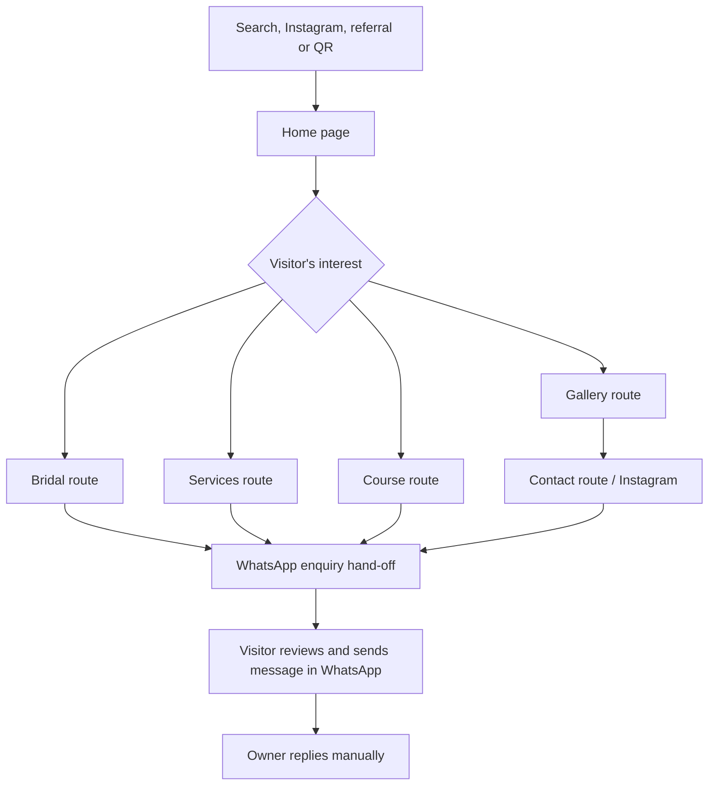

# User Stories and Journeys

**Document ID:** STORIES-KBS-001  
**Version:** 1.0 initial baseline  
**Status:** Proposed; owner/content approvals pending

## 1. Roles

| Role ID | Role | Primary needs | Access model |
|---|---|---|---|
| ROLE-01 | Bride / wedding party visitor | Evaluate bridal style, enquire about date, understand service expectations. | Public visitor; no login. |
| ROLE-02 | Everyday salon customer | Understand service offering, find location/hours and ask for price/availability. | Public visitor; no login. |
| ROLE-03 | Prospective course student | Understand course duration/topics and enquire about dates/fees. | Public visitor; no login. |
| ROLE-04 | Returning/referral customer | View gallery, share the website and contact the salon quickly. | Public visitor; no login. |
| ROLE-05 | Salon owner / authorised marketer | Approve content and images, receive enquiries, request updates. | Content approved in source-control workflow; no website admin account in release 1. |
| ROLE-06 | Developer / coding agent | Implement from approved spec, test and deploy safely. | Repository and hosting access controlled outside the public site. |

## 2. User journey overview

The path ends with a user-submitted external message, not an automatically stored booking. The website cannot verify the owner's reply or the availability of the requested date.

## 3. Story format

Priority: P0 blocks launch if absent; P1 required for release 1; P2 optional or requires a later decision. Each story cites requirements and test cases from `PDR.md` / `SYSTEM_DESIGN.md`.

## 4. Public visitor stories

### US-001 — Understand the business quickly

**As** a first-time visitor, **I want** to know the salon name, location and primary services from the opening screen, **so that** I can decide whether to enquire.

- **Priority:** P0
- **Requirements:** FR-001, FR-002, FR-004; NFR-001, NFR-009
- **Preconditions:** Owner has approved brand name and location wording; approved hero asset or neutral image fallback exists.
- **Success flow:** Visitor opens `/`; sees brand, Vadavalli/Coimbatore context, a concise hero statement and primary WhatsApp CTA; can reach Services, Bridal or Course.
- **Alternative flow:** Hero photo is not approved/available; use a tasteful brand-colour layout without inventing an image.
- **Failure scenario:** Invalid image path or long text breaks layout; page remains readable and CTA remains visible.
- **Acceptance criteria:**
  - AC-US001-1: Brand and local area are visible without opening a menu.
  - AC-US001-2: One primary CTA opens a WhatsApp draft with a general enquiry message.
  - AC-US001-3: Layout has no horizontal overflow at 320 px viewport width.
  - AC-US001-4: All heading/copy content remains visible with motion disabled.
- **Test links:** TC-001, TC-003, TC-011, TC-012.

### US-002 — Explore bridal makeup and enquire about a date

**As** a bride or family member, **I want** to view bridal service information and selected approved portfolio images, **so that** I can decide whether to ask about my wedding date.

- **Priority:** P0
- **Requirements:** FR-005, FR-008, FR-014
- **Preconditions:** At least a useful service description exists; images shown are approved or this story is tested with a safe no-image fallback.
- **Success flow:** Open `/bridal/`; read the overview/process; review approved gallery items; enter name, enquiry type and optional preferred date; choose the CTA; WhatsApp opens a prefilled draft.
- **Alternative flow:** Visitor does not want to use the form; a direct “Ask on WhatsApp” link offers a general enquiry.
- **Failure scenario:** Empty name or invalid input is rejected with clear inline feedback; WhatsApp is not opened until valid submission.
- **Acceptance criteria:**
  - AC-US002-1: Page contains no guarantee of date availability or results.
  - AC-US002-2: The desired date is included as a request, never as a confirmed appointment.
  - AC-US002-3: Visitor is told to review and manually send the WhatsApp message.
  - AC-US002-4: If no approved bridal image exists, no unrelated or unauthorised image is shown.
- **Test links:** TC-003, TC-004, TC-006, TC-007.

### US-003 — Understand everyday salon services

**As** a local customer, **I want** to browse available salon services, **so that** I can ask about a service and its price.

- **Priority:** P1
- **Requirements:** FR-006, FR-013, FR-015, FR-023
- **Preconditions:** Owner confirms which listed services are currently provided.
- **Success flow:** Visit `/services/`; see bridal makeup, hair styling/cuts, facials/skin care, and ear piercing only if current; use a service-specific CTA.
- **Alternative flow:** Prices have not been confirmed; CTA says “Ask for price” rather than showing a made-up price.
- **Failure scenario:** A service becomes unavailable; it is removed or marked unavailable in source content before production rebuild.
- **Acceptance criteria:**
  - AC-US003-1: Every published service has concise plain-language copy.
  - AC-US003-2: Each enquiry CTA selects the correct service context in the WhatsApp message.
  - AC-US003-3: No treatment claims promise a medical outcome.
- **Test links:** TC-003, TC-004, TC-019.

### US-004 — Enquire about the beautician course

**As** a prospective student, **I want** to see the course duration and topics, **so that** I can ask about batches, fees and enrolment.

- **Priority:** P1
- **Requirements:** FR-007, FR-014, FR-015
- **Preconditions:** Owner confirms the course is still offered and approves the 10-day wording/topic list.
- **Success flow:** Visit `/course/`; see “10-day” only if verified, review approved topics, choose the enrolment CTA, and WhatsApp opens an enquiry draft asking for next batch dates and fee.
- **Alternative flow:** Fee/batch date unavailable; page explicitly invites an enquiry instead of showing placeholder pricing.
- **Failure scenario:** A source poster has a historic course fee or date; do not publish it as current without confirmation.
- **Acceptance criteria:**
  - AC-US004-1: Topics cover skincare/facials, hair care/styling, makeup basics to advanced, threading/waxing, manicure/pedicure and basic bridal makeover, subject to owner verification.
  - AC-US004-2: Course fee, schedule, duration beyond the 10-day statement, certificate and outcomes are not invented.
  - AC-US004-3: Form data is not saved to a server.
- **Test links:** TC-004, TC-008, TC-005.

### US-005 — Browse gallery and enlarge an image

**As** a visitor comparing styles, **I want** to filter by service category and enlarge approved photos, **so that** I can inspect work without leaving the site.

- **Priority:** P1
- **Requirements:** FR-008, FR-009, FR-029
- **Preconditions:** Gallery manifest has approved items, alt text and suitable variants.
- **Success flow:** Open `/gallery/`; select Bridal/Hair/Care/Salon; tap a thumbnail; view the larger image; close with button, Escape or back control as implemented.
- **Alternative flow:** Category has no approved images; show a calm empty state and a link to Instagram instead of loading a raw unreviewed photo.
- **Failure scenario:** Image fails to load; accessible fallback text and close control remain usable.
- **Acceptance criteria:**
  - AC-US005-1: Filters work without page reload and remain keyboard operable.
  - AC-US005-2: Lightbox manages focus and can be closed with Escape.
  - AC-US005-3: No thumbnail-only 150×150 source is stretched to a large display.
  - AC-US005-4: Only items approved for publication appear.
- **Test links:** TC-006, TC-007, TC-016.

### US-006 — Find contact details and directions

**As** a visitor planning a visit, **I want** phone, WhatsApp, Instagram and location information, **so that** I can reach the salon using the channel I prefer.

- **Priority:** P0
- **Requirements:** FR-004, FR-013
- **Preconditions:** Phone and Instagram are verified; map pin/address is added only if owner supplies it.
- **Success flow:** Visit `/contact/`; click-to-call opens a dialler on supported devices; WhatsApp opens chat; Instagram opens the profile; map link opens directions.
- **Alternative flow:** No exact map link yet; show “Vadavalli, Coimbatore” and ask the visitor to message for directions.
- **Failure scenario:** External app is missing; web fallback or a plain phone/contact value stays available.
- **Acceptance criteria:**
  - AC-US006-1: Public phone and WhatsApp values match the owner's latest confirmation.
  - AC-US006-2: No invented street address, pin or opening hours are published.
  - AC-US006-3: External links opened in new tabs are safe.
- **Test links:** TC-001, TC-003, TC-015.

### US-007 — Learn about membership

**As** an existing or prospective customer, **I want** to know the salon has a Premium Membership Card and ask about its terms, **so that** I can decide whether to enquire.

- **Priority:** P1
- **Requirements:** FR-011, FR-014, BR-004
- **Preconditions:** Owner approves showing the existence of the card.
- **Success flow:** Visitor sees a compact card teaser and asks through WhatsApp what the benefits/price are.
- **Alternative flow:** Owner has not confirmed the offer remains active; keep this section hidden pending approval.
- **Failure scenario:** Old poster advertises outdated perks/discount; no terms are copied into live copy without validation.
- **Acceptance criteria:**
  - AC-US007-1: No benefit, discount, membership period or price is invented.
  - AC-US007-2: CTA is clearly an enquiry, not a checkout.
- **Test links:** TC-009, TC-019.

### US-008 — Understand the jewellery teaser without confusing it with salon services

**As** a visitor who saw jewellery on Instagram, **I want** a clear pointer to future jewellery information, **so that** I can enquire now without expecting an online store.

- **Priority:** P1
- **Requirements:** FR-012, BR-003, BR-011
- **Preconditions:** Owner approves keeping a jewellery teaser.
- **Success flow:** Visitor sees a compact statement that the jewellery store is separate/planned and an enquiry CTA to WhatsApp.
- **Alternative flow:** Once a dedicated website is approved, owner supplies a working URL and teaser CTA is updated.
- **Failure scenario:** No dedicated URL exists; do not link to a guessed store or show cart/product availability UI.
- **Acceptance criteria:**
  - AC-US008-1: No cart, checkout, inventory or rental availability functionality appears.
  - AC-US008-2: The teaser uses honest “enquire / coming soon” copy until approved URL exists.
- **Test links:** TC-009, TC-020.

### US-009 — Read approved FAQs and common booking guidance

**As** a visitor with a practical question, **I want** concise answers about booking, course and location, **so that** I can resolve basic uncertainty before contacting the salon.

- **Priority:** P1
- **Requirements:** FR-015, FR-016
- **Preconditions:** All answer text is approved by owner.
- **Success flow:** Visitor opens a question; answer is available to screen readers, keyboard and touch.
- **Alternative flow:** Question cannot yet be answered from known facts; response says to ask via WhatsApp.
- **Failure scenario:** FAQ states an unconfirmed price, policy or hours; remove it before release.
- **Acceptance criteria:**
  - AC-US009-1: Questions use facts approved by owner.
  - AC-US009-2: Any accordion is keyboard accessible and has an announced expanded/collapsed state.
- **Test links:** TC-013, TC-019.

### US-010 — Use the site on a phone with reduced motion

**As** a mobile visitor or a person who prefers reduced motion, **I want** the site to remain readable and navigable, **so that** I can use it comfortably.

- **Priority:** P1
- **Requirements:** FR-002, FR-018, FR-019, FR-027; NFR-001, NFR-003
- **Preconditions:** CSS and interaction scripts are loaded or disabled by browser settings.
- **Success flow:** Visitor navigates at 320–375 px width; menu operates; reveals either run gently or are skipped when reduced motion is requested.
- **Alternative flow:** GSAP fails to load; content remains visible and controls still work.
- **Failure scenario:** Initial styles hide sections forever when JS is unavailable; release is blocked.
- **Acceptance criteria:**
  - AC-US010-1: No horizontal overflow or CTA obstruction.
  - AC-US010-2: Reduced-motion mode disables parallax and non-essential transitions.
  - AC-US010-3: Content does not depend on animation to become visible.
- **Test links:** TC-011, TC-012, TC-013.

## 5. Owner and developer stories

### US-011 — Owner approves business details before launch

**As** the salon owner, **I want** to review public business details, service claims, course information and contact actions, **so that** the website does not publish outdated or inaccurate information.

- **Priority:** P0
- **Requirements:** FR-001, FR-013, FR-023, FR-030; BR-004
- **Preconditions:** Owner review checklist is presented.
- **Success flow:** Owner verifies the name, public number, location/map, offered services, course facts, fees/hours if published, and final copy; team records approval in the internal checklist.
- **Alternative flow:** Owner has not supplied a value; value remains omitted or enquiry-only.
- **Failure scenario:** Developer assumes a value from a poster without current confirmation; launch gate fails.
- **Acceptance criteria:**
  - AC-US011-1: All P0 business facts are approved before public launch.
  - AC-US011-2: Missing facts are visibly listed in internal handover, not shown as fake public values.
- **Test links:** TC-001, TC-008, TC-019.

### US-012 — Owner approves photos and protects client privacy

**As** the salon owner, **I want** to decide which images can appear publicly, **so that** the website showcases work responsibly and respects client consent.

- **Priority:** P0
- **Requirements:** FR-009, FR-028, FR-029; BR-006
- **Preconditions:** Asset guide and contact sheet are supplied.
- **Success flow:** Owner reviews candidate IDs, identifies subjects and permissions, approves/rejects them; only approved items enter the site manifest.
- **Alternative flow:** Permission is unavailable; choose another image, a non-identifying crop only if owner approves it, or a neutral visual.
- **Failure scenario:** Children, personal travel/family photos or unapproved clients are exposed on the public site.
- **Acceptance criteria:**
  - AC-US012-1: Every published image has an approval state and suitable alt text.
  - AC-US012-2: Unapproved files remain outside the build's public output.
  - AC-US012-3: A child image is never published without explicit parent/guardian approval.
- **Test links:** TC-006, TC-016.

### US-013 — Developer makes an auditable content change

**As** a developer, **I want** services, approved assets, contact details and SEO metadata centralised, **so that** an update is safe and easy to test.

- **Priority:** P1
- **Requirements:** FR-024, FR-025, FR-026; NFR-005–NFR-007
- **Preconditions:** Repository and test commands are configured.
- **Success flow:** Developer updates typed data, runs checks, inspects preview, receives owner approval and deploys.
- **Alternative flow:** Validation fails; fix data or block publication while retaining production.
- **Failure scenario:** Contact number is duplicated across many components and one stale occurrence remains.
- **Acceptance criteria:**
  - AC-US013-1: Public contact values come from one config object.
  - AC-US013-2: CI/build fails or flags invalid approved-gallery data.
  - AC-US013-3: Every release has a passing build and a production smoke test.
- **Test links:** TC-014, TC-015, TC-016.

### US-014 — Visitor switches to Tamil (conditional)

**As** a Tamil-speaking visitor, **I want** the page and enquiry flow in Tamil, **so that** I can understand the services in my preferred language.

- **Priority:** P2; release only if approved
- **Requirements:** FR-021, BR-010
- **Preconditions:** Owner requests Tamil support and a fluent reviewer approves all translations.
- **Success flow:** Visitor selects Tamil; every visible label, service description, error, FAQ and metadata has a translated equivalent.
- **Alternative flow:** Tamil is not approved or translation is incomplete; omit the toggle entirely in release 1.
- **Failure scenario:** Only headings/buttons are translated while form/errors and pages remain English.
- **Acceptance criteria:**
  - AC-US014-1: Translation coverage is complete for all enabled routes and interaction states.
  - AC-US014-2: Correct document language metadata is set.
- **Test links:** TC-018.

## 6. Story-to-requirement traceability

| User story | Main requirements | Core tests | Initial milestone |
|---|---|---|---|
| US-001 | FR-001–004 | TC-001–003, TC-011–012 | MS-02 / MS-03 |
| US-002 | FR-005, FR-008, FR-014 | TC-003–007 | MS-03 / MS-04 |
| US-003 | FR-006, FR-013, FR-015, FR-023 | TC-003–004, TC-019 | MS-03 |
| US-004 | FR-007, FR-014 | TC-004–005, TC-008 | MS-03 |
| US-005 | FR-008–009, FR-029 | TC-006–007, TC-016 | MS-04 |
| US-006 | FR-004, FR-013 | TC-001, TC-003, TC-015 | MS-03 / MS-06 |
| US-007 | FR-011, FR-014 | TC-009, TC-019 | MS-03 |
| US-008 | FR-012 | TC-009 | MS-03 |
| US-009 | FR-015–017 | TC-010, TC-013, TC-019 | MS-03 / MS-05 |
| US-010 | FR-002, FR-018–020, FR-027 | TC-011–013, TC-017 | MS-02 / MS-05 |
| US-011 | FR-001, FR-023, FR-030 | TC-001, TC-008, TC-019 | MS-00 / MS-06 |
| US-012 | FR-009, FR-028–029 | TC-006, TC-016 | MS-00 / MS-01 |
| US-013 | FR-024–026 | TC-014–016 | MS-01 / MS-05 / MS-06 |
| US-014 | FR-021 | TC-018 | MS-05 only if approved |

## 7. Common error scenarios and owner communication

- **Date enquiry does not open a chat:** show the verified number and a clear manual-message fallback. Tell the visitor that WhatsApp did not launch; do not claim the enquiry was received.
- **Visitor enters invalid data:** show field-level guidance, preserve valid form data and do not trigger an external redirect.
- **No current service/price info:** invite the visitor to ask. Do not fill gaps with assumptions.
- **Image has consent uncertainty:** remove it; a complete site may launch with fewer approved images rather than with questionable content.
- **Owner has not approved facts:** deploy only to preview; production promotion remains blocked.
